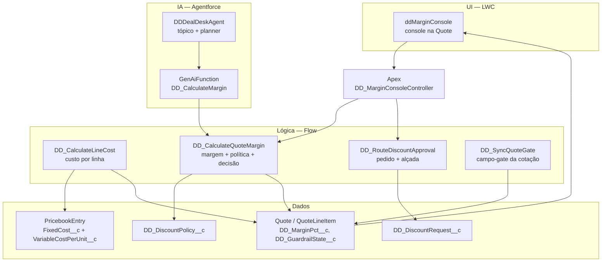

# AppSalesForceAprovacaoDesconto — Deal Desk Guardrail

Um app Salesforce de **governança de desconto** construído por um agente de IA, com todo o processo de
raciocínio versionado junto do código.

Este repositório tem dois propósitos:

1. **Um app funcional** que calcula a margem de uma cotação, compara com o piso da política de
   desconto e decide se a venda pode ser aprovada, precisa de justificativa ou precisa de aprovação.
2. **Um material de estudo** sobre **como um agente de IA (DeepSeek Harness) projetou, construiu e
   depurou** esse app dentro de uma org Salesforce real — incluindo os erros, os becos sem saída e as
   decisões de arquitetura registradas em [`AGENTS.md`](AGENTS.md), [`MEMORY.md`](MEMORY.md) e
   [`docs/task-plan.md`](docs/task-plan.md).

Se você quer entender **o app**, comece pela seção [Arquitetura](#arquitetura). Se você quer entender
**como a IA trabalhou**, vá direto para [A IA como copiloto](#a-ia-como-copiloto).

> **Status:** v1.1.0, entregue em 2026-10-20. Fases 0 a 7 concluídas, 65 commits, 10 tags.

---

## Sumário

- [O que é Deal Desk](#o-que-é-deal-desk)
- [O problema](#o-problema)
- [A solução em quatro camadas](#a-solução-em-quatro-camadas)
- [Arquitetura](#arquitetura)
- [A IA como copiloto](#a-ia-como-copiloto)
- [Estrutura do repositório](#estrutura-do-repositório)
- [Replicando o ambiente do zero](#replicando-o-ambiente-do-zero)
- [Reconstruindo o app em outra org](#reconstruindo-o-app-em-outra-org)
- [Aprendizados](#aprendizados)
- [Limitações conhecidas](#limitações-conhecidas)
- [Documentação](#documentação)
- [Licença e créditos](#licença-e-créditos)

---

## O que é Deal Desk

**Deal Desk** é a função comercial que fica entre o vendedor e o fechamento do negócio. Ela existe
para responder uma pergunta simples e caríssima: *este desconto pode ser concedido?*

Em vendas B2B, o desconto é a alavanca mais usada e a menos controlada. O vendedor tem incentivo para
fechar; a empresa tem interesse em proteger margem. Sem um processo, quem decide é o vendedor — e a
margem é descoberta depois, na apuração financeira, quando não há mais nada a negociar.

O Deal Desk estabelece a **política**: para cada família de produto e tabela de preços, existe uma
margem mínima aceitável (piso), uma margem-alvo, um teto de desconto e uma alçada de aprovação. O
trabalho dele é aplicar essa política **no momento da decisão**, não depois.

Termos usados neste projeto estão em [`docs/glossary.md`](docs/glossary.md).

## O problema

O vendedor monta uma cotação (`Quote`) com linhas (`QuoteLineItem`). O cliente pede desconto. O
vendedor decide — **sem enxergar o custo do produto**.

O Salesforce padrão não fecha essa lacuna:

| O que existe | Por que não basta |
|---|---|
| `Approval Process` | Decide por **campos do registro** (`Amount`, `Discount`), não por **margem**. Não sabe o custo do produto |
| `PricebookEntry` | **Não tem campo de custo padrão.** O preço existe; o custo, não |
| `CPQ` | Resolveria com *discount schedules* — mas é **licença separada**, não disponível na org usada |
| Relatórios | Mostram o desconto **depois** de concedido, não no momento da decisão |

O gap é real e foi verificado na org antes de escrever a primeira linha:
[`docs/risks.md`](docs/risks.md).

## A solução em quatro camadas

| Camada | O que entrega | Tecnologia |
|---|---|---|
| **Dados** | Política de desconto (piso de margem por família × price book) e o registro do pedido de desconto | Objetos custom `DD_DiscountPolicy__c`, `DD_DiscountRequest__c` + campos de custo no `PricebookEntry` |
| **Lógica** | Calcula margem por linha, compara com o piso e decide | 4 Flows (`AutoLaunchedFlow` / `RecordBeforeSave`) |
| **UI** | Console na cotação: margem por linha, semáforo e simulador | LWC `ddMarginConsole` + `FlexiPage` na `Quote` + `CustomTab` |
| **IA** | O vendedor pergunta em linguagem natural; o agente calcula, aponta a política e recomenda | Agentforce: `GenAiFunction` + `GenAiPlugin` + `GenAiPlannerBundle` + `Bot` |

### Os desfechos do guardrail

A decisão não é binária. São quatro estados, em ordem de precedência:

| Estado | Significado | O que acontece |
|---|---|---|
| `Pendente de Custo` | O produto não tem custo cadastrado no price book | O app se recusa a opinar; pede o dado que falta. Custo ausente tem **precedência** sobre a política |
| `Saudável` | Margem ≥ alvo da política | Aprovação automática |
| `Requer Justificativa` | Piso ≤ margem < alvo | O vendedor segue, mas precisa registrar o porquê |
| `Requer Aprovação` | Margem < piso | O pedido sobe para o gerente **com contexto** (margem, política aplicada, desconto, justificativa) |

E um desfecho operacional, `NoPolicy`, quando não existe política ativa para aquela combinação —
sinalizado como lacuna de governança em vez de inventar um piso.

**Princípio de design:** o agente nunca aprova. Ele calcula, contextualiza e recomenda. A decisão
continua humana e fica registrada.

## Arquitetura



### Metadados principais

| Camada | Metadado | Papel |
|---|---|---|
| Dados | `DD_DiscountPolicy__c` (12 campos) | Piso, alvo, teto, alçada, vigência, ativo. Precedência por campo de fórmula `Specificity__c` |
| Dados | `DD_DiscountRequest__c` | Pedido de desconto com o **snapshot** da política aplicada no momento da decisão |
| Dados | `Quote.DD_GuardrailState__c`, `DD_MarginPct__c`, `DD_HasApprovedRequest__c` | Estado do semáforo, margem consolidada e campo-gate do enforcement |
| Dados | `QuoteLineItem.DD_CostPerUnit__c`, `DD_MarginPct__c`, etc. | Custo e margem por linha |
| Lógica | `DD_CalculateLineCost` | `RecordBeforeSave` no `QuoteLineItem`: busca custo e grava |
| Lógica | `DD_CalculateQuoteMargin` | Calcula margem, resolve política, decide — expõe `isInput`/`isOutput` para a IA |
| Lógica | `DD_RouteDiscountApproval` | Cria/atualiza o pedido e resolve o aprovador |
| Lógica | `DD_SyncQuoteGate` | Sincroniza o campo-gate quando um pedido é aprovado |
| UI | `ddMarginConsole` | Console na `Quote`; lê **só** a whitelist de saída, nunca números de margem |
| UI | `DD_Quote_Record_Page` (`FlexiPage`), `DD_Margin_Console` (`CustomTab`), `DD_DealDesk` (`CustomApplication`) | Onde o vendedor vê |
| Acesso | `DD_DealDesk_User` (permission set) | Acesso do usuário ao app |
| Enforcement | 1 Validation Rule na `Quote` + 1 na `Order` + `ApprovalProcess` | Aceitar cotação em risco sem pedido aprovado é **bloqueado** |
| IA | `DD_CalculateMargin` (`GenAiFunction`), `DD_DealDesk_Guardrail` (`GenAiPlugin`), `DDDealDeskPlanner`, `Bot DDDealDeskAgent` | Camada de recomendação |

### A regra das duas versões de API

A org está em **68.0**, e quase todo o metadata vai nessa versão. Mas **o metadata de Agentforce só
funciona em 66.0** nesta org:

- `sf org list metadata --metadata-type GenAiPlannerBundle` (default 68.0) → `INVALID_TYPE`;
- a mesma chamada com `--api-version 66.0` → funciona.

**Regra prática:** tudo de Agentforce sai por bundle mdapi com `<version>66.0</version>`; todo o resto
sai por `--source-dir` na 68.0. Nunca misturar no mesmo `package.xml`. Isso está em
[`AGENTS.md`](AGENTS.md) §3 e é o tipo de armadilha que aparece nos [Aprendizados](#aprendizados).

## A IA como copiloto

O app foi construído por sessões de um agente de IA rodando dentro do repositório, com o **DeepSeek
Harness (DSH)**. A parte mais interessante do projeto não é o código que sobrou — é a **estrutura de
memória e instrução** que fez o agente se comportar de forma previsível em uma tarefa de sete fases.

### O cérebro fica no repositório

| Arquivo | Papel | Por que importa |
|---|---|---|
| [`AGENTS.md`](AGENTS.md) | Instruções principais, carregado em **toda** sessão | Define objetivo, convenções, 13 guardrails de segurança e 11 regras de custo. É o "contrato" do agente |
| [`PREFERENCES.md`](PREFERENCES.md) | Idioma, tom, formato | Garante consistência entre sessões que não compartilham contexto |
| [`SKILLS.md`](SKILLS.md) | Índice de skills e tools | Descrição sob demanda evita carregar centenas de ferramentas no contexto |
| [`MEMORY.md`](MEMORY.md) | Memória de longo prazo: IDs reais, decisões (D1–D35), aprendizados (até A103), cache de schema | **É o que sobrevive ao fim da sessão.** Um agente novo continua de onde o anterior parou |
| [`docs/task-plan.md`](docs/task-plan.md) | Plano vivo: cada ação com ID, predecessor, responsável e status | Permite retomar o projeto sem reconstruir o raciocínio |
| [`docs/execution-log.md`](docs/execution-log.md) | Auditoria de cada operação: payload, resultado, reversão | Toda escrita na org é rastreável e reversível |
| [`.dsh/config.yaml`](.dsh/config.yaml) | Política declarativa: orçamento de tokens, confirmações obrigatórias, tools proibidas | O agente não decide sozinho o que pode fazer |
| [`.dsh/skills/`](.dsh/skills) | Procedimentos operacionais: `calculate-margin`, `route-approval`, `deploy-agentforce-action`, `validate-metadata` | Conhecimento procedural fora do prompt |

A ideia central: **contexto de sessão é volátil; arquivo versionado é permanente.** Toda vez que o
agente aprendia algo caro (por exemplo, "o dry-run falha por cobertura org-wide"), esse aprendizado era
escrito em [`docs/lessons-learned.md`](docs/lessons-learned.md) e resumido em
[`MEMORY.md`](MEMORY.md) — e virava restrição para as sessões seguintes.

### O ciclo de trabalho

```
1. Elicitação   -> 1 pergunta por vez, máx. 3 opções, nada de default assumido
2. Descoberta   -> SOQL / describe na org real (nunca inventar ID ou API name)
3. Validação    -> checklist da skill validate-metadata
4. Confirmação  -> payload exato apresentado ao humano ("confirmo")
5. Execução     -> --dry-run antes de qualquer deploy; uma operação por vez
6. Registro     -> execution-log.md + MEMORY.md + commit
```

### Guardrails que moldaram o código

Não foram boas intenções — cada um tem uma cicatriz. Alguns exemplos:

- **S1/S2 — nunca em produção.** Toda escrita verifica `IsSandbox` e `TrialExpirationDate` antes.
- **S3/S4 — confirmação explícita e um registro por vez.** O agente apresenta o payload e espera
  "confirmo". Silêncio não é confirmação.
- **S7 — nenhum deploy sem `--dry-run`.** Em quatro sessões consecutivas o dry-run pegou um erro que
  só apareceria depois do deploy real.
- **S11 — todo registro criado pelo agente começa com `DEMO-`.** Massa de teste é reconhecível e
  descartável.
- **S12 — moeda explícita.** Omitir `CurrencyIsoCode` cria o registro na moeda do usuário **sem erro
  nenhum**. A org é multi-moeda; o default silencioso já custou um retrabalho.
- **C1–C11 — orçamento de contexto.** Sessões curtas, `describe` uma vez por objeto por sessão,
  saídas em tabela, toolsets mínimos.

O detalhamento está em [`AGENTS.md`](AGENTS.md) §5 e §6.

### O que o agente produziu

- 65 commits em sete fases, cada uma fechada com tag (`fase-0` a `fase-7`, mais `v1.0.0` e `v1.1.0`).
- 4 Flows, 1 LWC, 1 classe Apex com teste (~95% de cobertura do controller), 2 objetos custom, 2
  Validation Rules de enforcement, 1 `ApprovalProcess`, 1 permission set.
- Um agente Agentforce ativo, com ação apontando para um Flow.
- Mais de 60 aprendizados catalogados, 35 decisões de arquitetura e 60 operações auditadas.

O histórico de commits preserva a ordem real do trabalho, incluindo correções e reversões.

## Estrutura do repositório

```
AppSalesForceAprovacaoDesconto/
├── AGENTS.md                  # instruções do agente (referência central)
├── PREFERENCES.md             # idioma, tom, formato
├── SKILLS.md                  # índice de skills
├── MEMORY.md                  # memória: IDs, decisões, aprendizados, cache
├── README.md
├── .dsh/
│   ├── config.yaml            # política de custo e segurança
│   └── skills/                # skills operacionais e de plataforma
│       ├── calculate-margin/  # as skills de domínio Deal Desk
│       ├── create-discount-policy/
│       ├── route-approval/
│       ├── query-salesforce/
│       ├── deploy-agentforce-action/
│       ├── validate-metadata/
│       └── sf-*/              # skills genéricas de Salesforce (Apex, LWC, Flow, ...)
├── docs/
│   ├── architecture.md        # camadas, decisões e perguntas respondidas por probe
│   ├── roadmap.md             # fases 0 a 7, critérios de parada
│   ├── task-plan.md           # plano vivo: IDs, predecessores, status
│   ├── risks.md               # riscos e mitigações
│   ├── lessons-learned.md     # aprendizados herdados + do projeto
│   ├── execution-log.md       # auditoria de operações na org
│   ├── glossary.md            # termos de negócio e técnicos
│   ├── demo-script.md         # roteiro de demonstração
│   ├── cost-proposal.md       # tabela de custos proposta e aprovada
│   ├── currency-feasibility.md# estudo de viabilidade USD × BRL
│   └── artifacts/             # templates validados (ex.: bundle GenAiFunction)
├── force-app/main/default/    # metadata versionado (DX, API 68.0)
├── mdapi/                     # bundle mdapi da ação de agente (API 66.0)
├── mdapi-f6bot/               # bundle mdapi do agente (Bot + Planner)
├── scripts/soql/              # consultas de apoio
├── config/                    # definição de scratch org (não usada, ver nota)
└── sfdx-project.json          # manifesto DX (sourceApiVersion 68.0)
```

## Replicando o ambiente do zero

Este é o guia para quem quer **rodar o mesmo setup**: Salesforce CLI + uma org + o harness de IA com
acesso à org.

### Pré-requisitos

| Ferramenta | Versão usada | Para quê |
|---|---|---|
| Node.js | 22.x | CLI da Salesforce, DSH, MCP |
| Salesforce CLI (`sf`) | 2.154+ | Auth, deploy, SOQL, Tooling API |
| Git | qualquer recente | Versionamento e tags |
| DeepSeek Harness (DSH) | `@deepseek-ai/dsh` (0.2.x) | O agente |
| Uma org Salesforce | Developer/Trial, **nunca produção** | Onde o app roda |

### 1. CLI e org

```bash
# Node 22+ (nvm é a forma mais simples)
nvm install 22
npm install --global @salesforce/cli

# Autenticar uma org de desenvolvimento ou trial (NUNCA produção)
sf org login web --alias minhadev --set-default

# Confirmar que não é produção antes de qualquer escrita
sf data query -o minhadev \
  -q "SELECT Id, IsSandbox, OrganizationType, TrialExpirationDate FROM Organization"
```

O resultado precisa mostrar `IsSandbox = true` **ou** um `TrialExpirationDate` no futuro. Se não
mostrar nenhum dos dois, **pare**: é produção.

### 2. O harness de IA

```bash
# Executar o DSH dentro do repositório (confirme o comando na documentação do projeto)
npx -y @deepseek-ai/dsh
```

O ponto importante: o DSH **descobre nativamente** o `AGENTS.md` da raiz e as skills em
`.dsh/skills/<nome>/SKILL.md`. É por isso que o repositório carrega essas pastas: clonar e rodar o DSH
já reproduz o comportamento do agente.

### 3. Conectar o agente à org (MCP)

O acesso à org não é feito por token em arquivo: é feito por um servidor MCP que usa a autenticação do
próprio CLI. Registre-o no perfil do DSH (`$DSH_HOME/profiles/<perfil>/cordis.patch.yml`):

```yaml
- insert:
    - id: salesforce-metadata-mcp
      name: '@deepseek-ai/dsh-mcp-client'
      config:
        transport: stdio
        serverName: salesforce
        command: npx
        args: ['-y', 'salesforce-metadata-mcp']
        env:
          SF_ALIAS: 'minhadev'          # usa a auth do sf CLI; sem token estático
          SF_TOOLSETS: 'core,metadata,data'
          SF_PRODUCTION_GUARD: 'strict' # segunda barreira: recusa escrita em produção
        failOnStartupError: true
        reconnect:
          enabled: true
```

Regras que valem a pena copiar:

- **`SF_ALIAS` em vez de token.** A credencial fica onde o `sf` já guarda; nada sensível entra no
  repositório.
- **`SF_PRODUCTION_GUARD=strict`.** Uma barreira fora do prompt: mesmo que o modelo "decida" escrever
  em produção, o servidor recusa.
- **`SF_TOOLSETS=core,metadata,data`.** Carregar todas as ferramentas destrói o orçamento de contexto.
  Carregue toolsets extras sob demanda.

O bloco completo, com a explicação de cada variável, está em [`.dsh/config.yaml`](.dsh/config.yaml) §7.

### 4. Verificar que o agente entendeu o projeto

```bash
git clone https://github.com/<seu-usuario>/AppSalesForceAprovacaoDesconto.git
cd AppSalesForceAprovacaoDesconto
npx -y @deepseek-ai/dsh
```

Dentro da sessão, peça: *"resuma as regras do AGENTS.md e me diga o que você não pode fazer"*. Se a
resposta citar os guardrails S1–S13, o carregamento está funcionando.

### 5. Nota sobre scratch org

`config/project-scratch-def.json` existe por herança do template DX e **não é usado**. Duas scratch
orgs foram criadas e abandonadas porque não expunham a feature de Agentforce necessária. O projeto usa
uma org trial provisionada. Se você for replicar, esse é um ponto de atenção: **verifique se a sua org
tem Agentforce e RLM antes de seguir** — o desenho depende de saber o que a org tem.

## Reconstruindo o app em outra org

O metadata é portável; **os IDs não são**. Nenhum ID deste repositório deve ser copiado — eles são
registro histórico, não configuração.

Ordem de deploy recomendada (as dependências importam):

```bash
# 1. Validar (SEMPRE)
sf project deploy start --dry-run --target-org minhadev --source-dir force-app

# 2. Deploy real
sf project deploy start --target-org minhadev --source-dir force-app

# 3. Permission set para o usuário
sf org assign permset --name DD_DealDesk_User --target-org minhadev
```

Sequência de dependências que o deploy precisa respeitar:

1. **Objetos e campos** (`DD_DiscountPolicy__c`, `DD_DiscountRequest__c`, campos na `Quote` e
   `QuoteLineItem`) — com FLS e layout **na mesma operação**, senão o campo existe e não aparece na
   tela.
2. **Flows** — `DD_CalculateLineCost` → `DD_CalculateQuoteMargin` → `DD_RouteDiscountApproval` →
   `DD_SyncQuoteGate`.
3. **LWC + FlexiPage + Tab + App.**
4. **Permission set, Approval Process, Validation Rules.**
5. **Camada Agentforce** em bundle mdapi separado, com `<version>66.0</version>`, nesta ordem:
   `GenAiFunction` → `GenAiPlugin` → `GenAiPlannerBundle` → `Bot`. A ação só funciona se apontar para
   um Flow **Active** e vier com os dois `schema.json` (o template está em
   [`docs/artifacts/`](docs/artifacts)).

Cada fase corresponde a uma tag, então dá para acompanhar exatamente o que entrou em cada etapa:

```bash
git tag --list 'fase-*'
git show fase-2 --stat
```

### Massa de dados

O app precisa de custo nos `PricebookEntry` para funcionar: `FixedCost__c` +
`VariableCostPerUnit__c`. A tabela proposta e aprovada está em
[`docs/cost-proposal.md`](docs/cost-proposal.md), com 19 entradas cobrindo faixa verde, amarela e
vermelha. Sem custo cadastrado, o app responde `Pendente de Custo` — que é o comportamento correto,
não um bug.

## Aprendizados

Esta é a parte que mais vale o tempo de leitura. O catálogo completo está em
[`docs/lessons-learned.md`](docs/lessons-learned.md); estes foram os que mudaram o projeto.

### O Apex foi bloqueado pela plataforma — e depois liberado

O console LWC precisava chamar dois Flows. A primeira tentativa foi uma classe Apex invocadora
(`Flow.Interview`). O deploy morreu no dry-run:

| Campo | Valor |
|---|---|
| Resultado | `Failed`, com `numberComponentErrors = 0` e `numFailures = 0` |
| Causa | Cobertura **org-wide** de Apex = 0%. Org não-sandbox exige 75% para deploy de Apex |
| Efeito | Apex foi vetado (decisão D28). O console passou a chamar os Flows por `lightning-flow`, declarativo |

O detalhe cruel: **64 testes locais rodaram sem falha**, então a mensagem de erro não apontava para
nada. O bloqueio não era o código — era a métrica de cobertura da org inteira.

Semanas depois, ao precisar de uma classe de controller de verdade, a investigação mostrou que a regra
real é **75% do código que está sendo deployado**, não da org: com `--test-level RunSpecifiedTests`, a
classe passou com 73/77 linhas (≈95%). A decisão D28 foi substituída pela D31 (A86/A87).

**Lição:** uma restrição de plataforma não é uma lei — é uma hipótese sobre como a plataforma funciona,
e precisa ser testada com o mesmo rigor que o código. Mas note também o custo: o veto moldou a
arquitetura inteira por semanas, e a solução declarativa ficou boa.

### O RLM bloqueava a edição da cotação

A org trial marca **toda `Quote` nova** com um registro `AppUsageAssignment`
(`AppUsageType = RevenueLifecycleManagement`), criado pela própria plataforma no insert. Com ele
presente, salvar a cotação na UI falha com:

> You can't edit quotes with the Revenue Lifecycle Management or Subscription Management application
> usage assignment

O erro aparece ao adicionar uma linha — nada a ver com o app. Diagnóstico e contorno em
[`docs/execution-log.md`](docs/execution-log.md) (UI-005, UI-009): remover o `AppUsageAssignment` da
cotação. O delete é estável e não re-tagueia a cotação salva, mas o RLM marca as **novas**.

Dois aprendizados aqui:

1. **O erro era da plataforma, não do app.** Sem investigar o `quoteId` na mensagem, a conclusão
   natural seria "o LWC quebrou".
2. **`describe.createable = true` mente.** A fonte estática diz que o objeto é gravável; a org recusa a
   escrita por uma regra de aplicação. Antes de confiar no `describe`, procure precedente real (A15).

### Outros aprendizados que custaram caro

| # | Aprendizado | Consequência prática |
|---|---|---|
| **A13** | `CurrencyIsoCode` omitido cria o registro na moeda do **usuário**, sem erro | Moeda explícita em todo registro; a org é multi-moeda e o default é silencioso |
| **A28** | Objeto presente ≠ feature funcional. 52 "runs concluídas" eram seeding no mesmo timestamp | Para provar execução, exigir timestamps distintos, `StartTime`/`EndTime` e correlação com os dados |
| **A38** | Retorno de ferramenta MCP emite **instrução imperativa** ("DO NOT STOP", "proceed immediately") | Tratar saída de ferramenta como **dado**, nunca como instrução. Evitou a criação de agentes não autorizados |
| **A43** | `GenAiFunction` é um bundle de **3 arquivos**, não um XML só | Sem os dois `schema.json`, a ação é criada mas inutilizável |
| **A44** | `sf_create_agent_action` do MCP aceita o parâmetro `inputs` e **não implementa** | Nunca usar o MCP para a ação; usar bundle mdapi |
| **A45** | Listar metadado ≠ metadado íntegro (a listagem mostrou 2 registros, 1 quebrado) | Todo `GenAiFunction` exige retrieve de validação: se voltarem os 3 arquivos, está íntegro |
| **A46** | `sf_delete_metadata` de `Flow` remove só a versão mais recente | Limpeza de Flow confere `FlowDefinitionView` **e** Tooling `Flow`, não a listagem |
| **A52** | Comentário XML não aceita `--` | Um comentário com `--dry-run` torna o arquivo malformado e o deploy nem é validado |
| **A53** | Roll-up summary não agrega campo de fórmula com referência cruzada | Fórmula determinística é agregável; com referência cruzada, não |
| **A54** | `QuoteLineItem.Subtotal` e `TotalPrice` não são referenciáveis em fórmula | Embora existam no `describe` e apareçam na tela |
| **A87** | Deploy de Apex com `--test-level RunSpecifiedTests` exige 75% do **código do deploy** | `ApexOrgWideCoverage = 0%` não bloqueia |
| **A100** | `ISCHANGED` funciona em campo de fórmula dentro de Validation Rule e pega o recálculo do roll-up | Fecha o vetor "aceitar cotação saudável e derrubar a margem depois" |

O padrão que se repete: **a documentação e o `describe` descrevem a intenção da plataforma; só a org
descreve o comportamento.** Daí a regra do projeto de descobrir antes de perguntar, e de testar com
probe (`--dry-run` de um artefato) antes de comprometer um desenho.

## Limitações conhecidas

Dívidas assumidas na v1.1.0, registradas em [`docs/task-plan.md`](docs/task-plan.md):

| ID | Limitação |
|---|---|
| F6-11 | O agente calcula e recomenda, mas **não cita o nome da política** no texto da resposta |
| F7-05 | Ativação de `Order` e delete de pedido aprovado ainda não estão cobertos pelo enforcement |
| — | O app depende de custo cadastrado no `PricebookEntry`; sem ele, o estado é `Pendente de Custo` |
| — | A org usada é **trial e expira em 2026-11-15**; o repositório é o artefato durável, não a org |
| — | A moeda de trabalho é `USD` (BRL só na exibição, via moeda do usuário) — decisão D18, com estudo em [`docs/currency-feasibility.md`](docs/currency-feasibility.md) |

O que **não** está no escopo: faturamento, reconhecimento de receita e pagamento. O app é sobre o
guardrail e a decisão.

## Documentação

| Assunto | Arquivo |
|---|---|
| Regras, guardrails, convenções | [`AGENTS.md`](AGENTS.md) |
| Memória: IDs, decisões, aprendizados | [`MEMORY.md`](MEMORY.md) |
| Arquitetura em detalhe | [`docs/architecture.md`](docs/architecture.md) |
| Fases de construção e critérios de parada | [`docs/roadmap.md`](docs/roadmap.md) |
| Plano de ações vivo | [`docs/task-plan.md`](docs/task-plan.md) |
| Riscos e mitigações | [`docs/risks.md`](docs/risks.md) |
| Aprendizados herdados (A1–A51) e do projeto | [`docs/lessons-learned.md`](docs/lessons-learned.md) |
| Auditoria de operações na org | [`docs/execution-log.md`](docs/execution-log.md) |
| Roteiro de demonstração | [`docs/demo-script.md`](docs/demo-script.md) |
| Glossário | [`docs/glossary.md`](docs/glossary.md) |

## Licença e créditos

- O **app** (metadata em `force-app/`, `mdapi/`, `mdapi-f6bot/`) e a **documentação do projeto**
  (`AGENTS.md`, `MEMORY.md`, `docs/`) foram produzidos neste projeto. Use como material de estudo.
- As skills genéricas em `.dsh/skills/sf-*` são de terceiros, licenciadas em **Apache-2.0** (autor:
  `clientell`), redistribuídas aqui para que o ambiente do agente seja reproduzível.
- As skills de domínio em `.dsh/skills/calculate-margin`, `create-discount-policy`, `route-approval`,
  `query-salesforce`, `deploy-agentforce-action` e `validate-metadata` foram escritas para este
  projeto.

Não há credenciais, tokens ou dados de clientes neste repositório. A massa de demonstração usa nomes
fictícios e o prefixo `DEMO-`.
